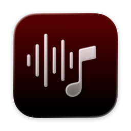
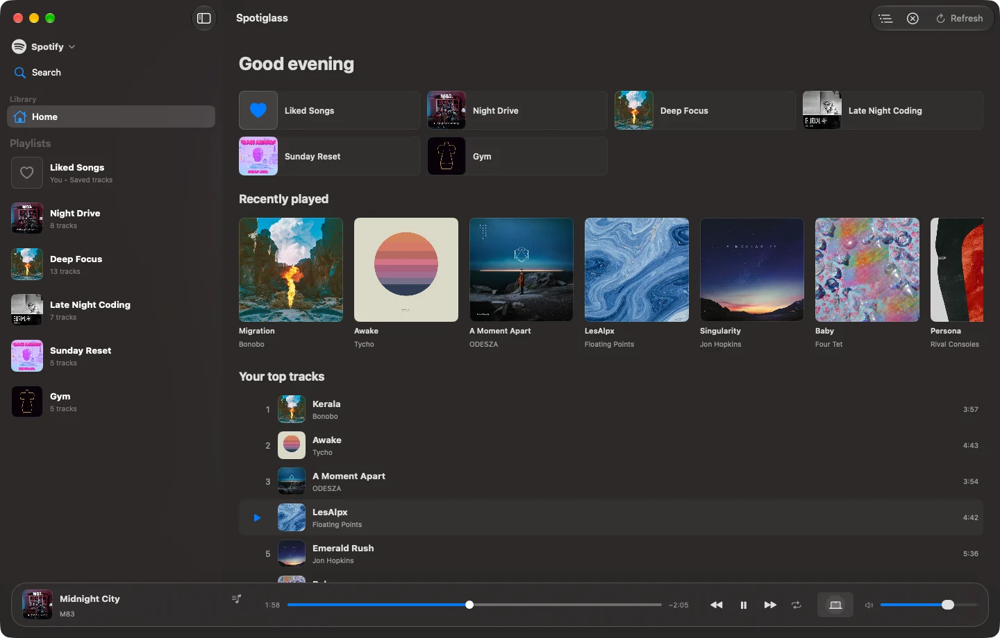
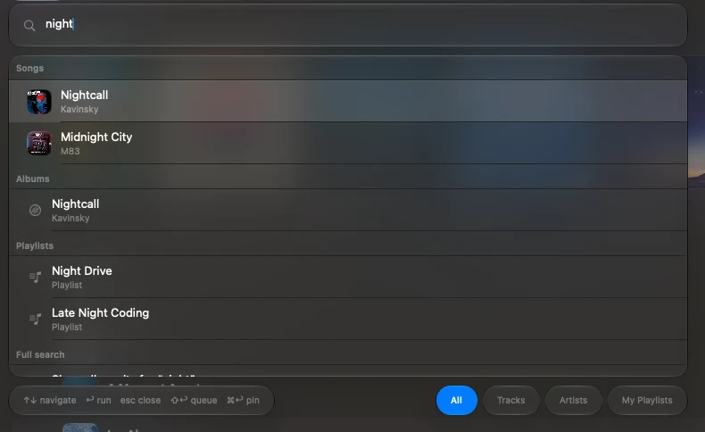
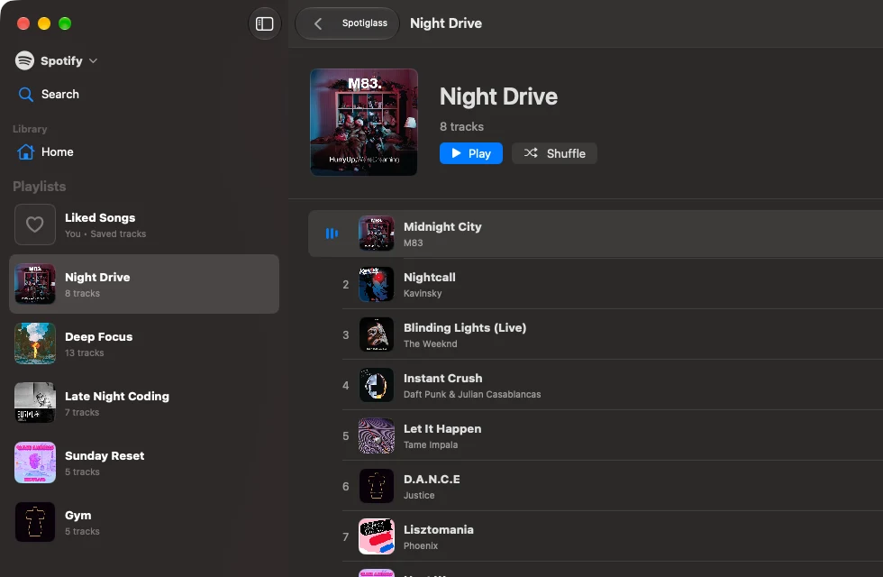
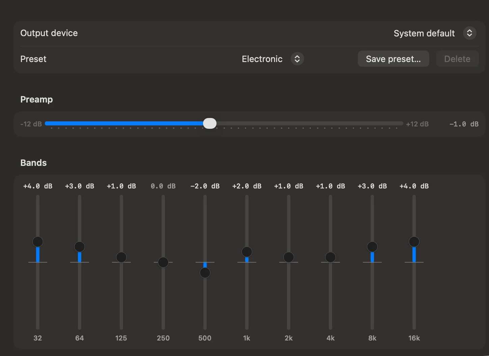

<p align="center">
  
</p>

<h1 align="center">Spotiglass</h1>

<p align="center">
  Native macOS client for Spotify and Apple Music in a glass-style SwiftUI shell: Spotify through its Web API and Web Playback SDK, Apple Music through MusicKit.
</p>

<p align="center">
  <a href="docs/getting-started.md">Get started</a>
  ·
  <a href="docs/building-and-testing.md">Build and test</a>
  ·
  <a href="docs/ci-and-releases.md">Release artifact</a>
  ·
  <a href="docs/README.md">Documentation</a>
</p>

<p align="center">
  
</p>

## What you get

- Spotify and Apple Music side by side. Switch with the service at the top left of the sidebar (⌃1 Apple Music, ⌃2 Spotify); each keeps its own sign-in, pins and place.
- Playlist and track browsing with sidebar pins, queue, artist pages, and command palette search.
- In-app playback: Spotify through the Web Playback SDK in a hidden `WKWebView`, Apple Music through MusicKit's player.
- Appearance controls for System, Light, or Dark, plus command palette backdrop blur.
- Keychain-backed refresh tokens, local playlist cache, and keyboard shortcuts you can remap in Settings.

## Screenshots

| Command palette (⌘K) | Playlist |
|---|---|
|  |  |

<p align="center">
  
</p>

All screenshots are the real app, captured in [screenshot mode](docs/screenshots.md) with a sample library (no Spotify account involved).

## Requirements

- macOS **26** or newer.
- **Apple Music:** an Apple Music subscription for playback. Nothing to set up.
- **Spotify:** a [Spotify Developer](https://developer.spotify.com/dashboard) app client ID (PKCE public client; no client secret) and **Spotify Premium** for Web Playback SDK streaming.
- To build from source: Xcode that matches the project deployment target.

See [Limitations](docs/limitations.md) for signed releases versus preview builds, Gatekeeper, and operational constraints.

## Quick start

1. Download the signed `.dmg` from the [latest release](https://github.com/isaaclins/spotiglass/releases/latest), or open `Spotiglass.xcodeproj` and run the **Spotiglass** scheme.
2. On the welcome screen, pick the service you listen on.
   - **Apple Music:** allow access when macOS asks.
   - **Spotify:** create a Spotify app in the [Spotify Developer Dashboard](https://developer.spotify.com/dashboard), enable Web Playback SDK, set the redirect URI to `http://127.0.0.1:43824/callback`, then paste the client ID and connect.
3. Add the other service any time with **Add a service…** at the top left of the sidebar.

Setup details, OAuth scopes, and manual playback checks: [Getting started](docs/getting-started.md) and [Apple Music](docs/apple-music.md).

## Build, test, and run

From the repository root:

```sh
make build
make test
make run
```

Unsigned Release bundle (same layout as CI):

```sh
make release
```

Output: `build/DerivedData/Build/Products/Release/Spotiglass.app`.

For raw `xcodebuild` commands, test-host Keychain behavior, and icon pipeline notes, see [Building and testing](docs/building-and-testing.md).

## Release artifact

The GitHub Actions workflow **Release artifact** runs unit tests, builds an unsigned Release `Spotiglass.app`, and uploads it for 14 days. It is a preview for testing a branch, not a release: [CI and releases](docs/ci-and-releases.md).

## Documentation

| Guide | Description |
|-------|-------------|
| [Getting started](docs/getting-started.md) | Spotify dashboard setup, OAuth scopes, first run |
| [Apple Music](docs/apple-music.md) | Adding Apple Music, switching services, what maps where, known gaps |
| [Building and testing](docs/building-and-testing.md) | `make`, `xcodebuild`, local Release bundle |
| [CI and releases](docs/ci-and-releases.md) | Workflow dispatch artifact, Gatekeeper |
| [Data storage](docs/data-storage.md) | Keychain, cache paths, `settings.json` |
| [Pinning](docs/pinning.md) | Sidebar pins and drag targets |
| [Screenshots](docs/screenshots.md) | Screenshot mode: capture the real UI with sample data |
| [Limitations](docs/limitations.md) | Premium, signing, API limits |

## Regenerate README logo

The README logo is exported from the app icon pipeline:

```sh
scripts/generate_readme_logo.sh
```

Use `scripts/generate_readme_logo.sh --rebuild` to force a fresh unsigned Release build first.

## Support

If Spotiglass has been useful and you want to support ongoing development:

- [Buy Me a Coffee](https://buymeacoffee.com/isaaclins) — tips fund releases and docs; see [SUPPORT.md](SUPPORT.md) for details.

## Contributing

Open an issue describing the change you want to make before opening a pull request so scope and direction stay aligned.

## License

See [LICENSE](LICENSE). Personal, non-commercial use is permitted under the repository license; commercial or organizational use requires a separate written license from the copyright holder.
