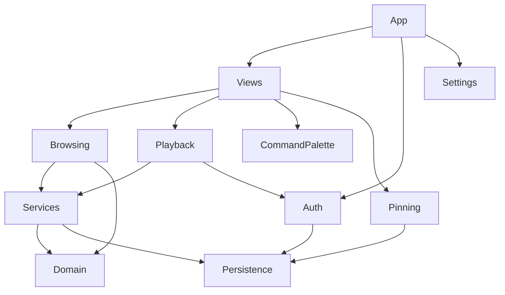

# Architecture

Spotiglass is a native macOS SwiftUI app: OAuth PKCE sign-in, Spotify Web API for
library data, and Web Playback SDK audio through a hidden `WKWebView`.

## Module map

| Folder | Responsibility |
|--------|----------------|
| [`Spotiglass/App/`](../Spotiglass/App/) | `@main`, environment objects, Settings scene, test vs production Keychain |
| [`Spotiglass/Auth/`](../Spotiglass/Auth/) | PKCE, loopback OAuth, token refresh, `AuthViewModel` |
| [`Spotiglass/Services/`](../Spotiglass/Services/) | `SpotifyAPIClient`, DTO decoding, GET cache, LRC lyrics client |
| [`Spotiglass/Domain/`](../Spotiglass/Domain/) | Service-neutral models (`MusicTrack`, `MusicPlaylistSummary`, ...) decoupled from wire DTOs |
| [`Spotiglass/Browsing/`](../Spotiglass/Browsing/) | `MusicBrowsingProvider`, row view models, load state, sidebar library types |
| [`Spotiglass/Views/`](../Spotiglass/Views/) | SwiftUI shell: playlist browser UI, immersive lyrics, queue, chrome |
| [`Spotiglass/Playback/`](../Spotiglass/Playback/) | Web Playback host, session VM, queue VM, transport controls |
| [`Spotiglass/CommandPalette/`](../Spotiglass/CommandPalette/) | ⌘K search, keymaps, command catalog |
| [`Spotiglass/Pinning/`](../Spotiglass/Pinning/) | Sidebar pins, drag-and-drop transfer types |
| [`Spotiglass/Persistence/`](../Spotiglass/Persistence/) | Keychain refresh tokens, playlist disk cache, lyrics cache |
| [`Spotiglass/Settings/`](../Spotiglass/Settings/) | `settings.json`, appearance, playback prefs, account UI |
| [`Spotiglass/Utilities/`](../Spotiglass/Utilities/) | Cross-cutting helpers (artwork cache, rate-limit display, width policy) |
| [`Spotiglass/Infrastructure/`](../Spotiglass/Infrastructure/) | Shared logging (`SpotiglassLog`) |

## Dependency direction

- **Views** depend on view models and services; they do not decode JSON directly.
- **Services** map Spotify DTOs → **Domain** models via `domainModel()`.
- **Browsing** and the views it feeds talk to a `MusicBrowsingProvider`, not to `SpotifyAPIClient`. See [Music providers](#music-providers).
- **Playback** (`PlaybackSessionViewModel`, `QueueViewModel` and the playback controls) talks to a `MusicPlaybackProvider`, not to `SpotifyPlaybackAPI` or the SDK page.
- **Auth** owns tokens; **Playback** requests playback-scoped access tokens through a bridge.

## Music providers

Apple Music support (#372) lands as a series of small changes; the first one puts
a service-neutral layer between the browser and Spotify without changing what
anyone sees.

| Piece | Where | Status |
|-------|-------|--------|
| Domain models (`MusicTrack`, `MusicPlaylistSummary`, `MusicArtistDetail`, `MusicSearchResults`, ...) | `Domain/MusicDomain.swift` | Neutral. Renamed from `Spotify*`; the Codable shape is unchanged, so existing caches keep loading. |
| Browsing: home feed, library playlists, playlist / album / artist detail, liked tracks, search, library edits | `Browsing/MusicBrowsingProvider.swift` | Neutral protocol. `SpotifyAPIClient` conforms in `Services/SpotifyAPIClient+MusicBrowsingProvider.swift`. |
| Apple Music browsing | `Services/AppleMusic*.swift`, `Views/AppleMusicBrowserRoot.swift` | `AppleMusicBrowsingProvider` over MusicKit, read-only. Behind a hidden developer switch until the service switcher (#373); see [Apple Music](apple-music.md). |
| Playback models (`MusicPlaybackSnapshot`, `MusicRepeatMode`, `MusicPlaybackDevice`, `MusicPlaybackQueue`, `MusicPlaybackEvent`, ...) | `Playback/MusicPlaybackModels.swift` | Neutral. Renamed from `Spotify*`; the Spotify wire DTOs keep their names. |
| Playback: play items or a context, pause / resume, seek, skip, shuffle / repeat, volume, queue read and enqueue, player state reads and events | `Playback/MusicPlaybackProvider.swift` | Neutral protocol. `SpotifyPlaybackProvider` wraps `SpotifyPlaybackAPI` (Web API) and the Web Playback SDK page. `PlaybackSessionViewModel` and `QueueViewModel` only see the protocol. |
| Auth and session (connect, disconnect, current account) | `Auth/` | Still Spotify-specific. Next slice. |
| Browsing errors | `SpotifyAPIError` | The view models still map Spotify errors. Apple Music failures surface through `localizedDescription` (`AppleMusicBrowsingError` and MusicKit's own errors). |
| Track URIs (`spotify:track:` checks) | `Browsing/PlaylistBrowserViewModel+TrackMutations.swift`, `Browsing/TrackRowViewModel.swift`, `Browsing/LibraryContinuation.swift`, `Browsing/BrowsingLoadState.swift`, `Pinning/PinnedItem.swift`, `Views/PlaylistBrowser/` | Still Spotify-specific: playlist edits, Liked Songs, pinning a track row and some detail actions only accept `spotify:track:` URIs, so Apple Music tracks (`applemusic:song:...`) are skipped there. That is harmless while Apple Music is read-only; it moves behind the provider with Apple Music library edits (#374). Pins are saved on disk, so that change has to keep existing pins loading. |
| Search paging (`MusicSearchPaging.next`) | `Browsing/CatalogSearchViewModel.swift` | Still Spotify-shaped: the Search view reads the `offset` query item out of Spotify's `next` URL, falling back to `offset + pageSize`. The Apple Music provider hands back an opaque `applemusic://page?offset=` continuation in the same shape, so its 25-item pages line up. |

Rules for the neutral layer:

- `id` is the owning service's identifier and `uri` an opaque playback reference;
  only that service should interpret them. This is the goal, not yet the state:
  see the "Track URIs" row above.
- Paging continuations (`MusicArtistAlbumsPage.next`) are handed back to the
  same provider unchanged, never built by callers.
- Requirements a service cannot serve keep the protocol's default: an empty result
  for feeds (shown as an empty section) or an "unsupported" error for library edits.
- Spotify-only features are optional capabilities, so the UI asks instead of
  assuming. On the playback provider: `deviceTransfer` (Spotify Connect; the
  device menu hides its device list without it), `.reloadablePlayer` (soft reset
  and reload of the hidden SDK page; without it recovery only retries connect)
  and `.pushesPlayerState` (SDK state events; without it the in-app player is
  treated like a remote device: state comes from reads and play / pause are
  confirmed optimistically until a read agrees). Client-ID entry follows with
  the session protocol.
- Player state reads may lag commands (MusicKit's `ApplicationMusicPlayer`
  still reports "playing" right after `stop()`). For a few reads after a pause,
  resume or play the session only applies a read whose play / pause agrees with
  it; a skip in between keeps that expectation. Seek, shuffle and repeat have
  their own pending-command guards.
  Without pushed state it also keeps polling while the app is in the background,
  treats an empty read as "nothing playing", and doesn't mark a constant player
  id as stale when it reconnects.

Apple Music browsing uses `MusicLibraryRequest`, `MusicCatalogSearchRequest`,
`MusicLibrarySearchRequest`, `MusicRecentlyPlayedRequest` and
`MusicPersonalRecommendationsRequest`; playback through `ApplicationMusicPlayer` is the
next slice.

## Data and secrets

| Data | Location | Doc |
|------|----------|-----|
| Refresh token | Keychain (`com.isaaclins.spotiglass.spotify-auth`) | [data-storage.md](data-storage.md) |
| Settings | Application Support `settings.json` | [data-storage.md](data-storage.md) |
| Playlist cache | On-disk under app cache | [data-storage.md](data-storage.md) |
| OAuth callback | `127.0.0.1:43824` during sign-in | [getting-started.md](getting-started.md) |

## Playback pipeline

1. The app-scoped `SpotiglassPlaybackHost` retains one `WKWebView`; `SpotiglassPlaybackHostView` mounts it into a live scene and it loads bundled `SpotifyPlaybackHost.html`.
2. JavaScript SDK posts events to Swift (`SpotifyPlaybackBridge`), which hands them to `SpotifyPlaybackProvider`; the provider passes them to the session through `eventHandler`.
3. `PlaybackSessionViewModel` coordinates device transfer, transport polls, and UI state, and sends every command through its `MusicPlaybackProvider`.
4. `SpotifyPlaybackProvider` turns those commands into `SpotifyPlaybackAPI` REST calls (play, queue, devices, transport) or SDK page commands (connect, toggle, volume).

## Browsing layout (current)

Refactor in progress:

- Protocols, row VMs, `PlaylistBrowserViewModel` (+ concerns), and playlist-browser helpers: `Spotiglass/Browsing/`
- Browser UI: `Spotiglass/Views/PlaylistBrowser/`

## Localization

- String Catalog: `Spotiglass/Localizable.xcstrings`
- Settings strings migrated first; remaining views follow in later passes.

## Logging

`SpotiglassLog` (`os.Logger` categories) is used in App, Pinning, Settings, Persistence,
and Domain. Auth, Services, Playback session, and Views adopt logging incrementally.

## Tests

Unit tests live in `SpotiglassTests/` with protocol mocks and ViewInspector for views.
The test host uses an in-memory refresh-token store when `XCTestConfigurationFilePath` is set.
